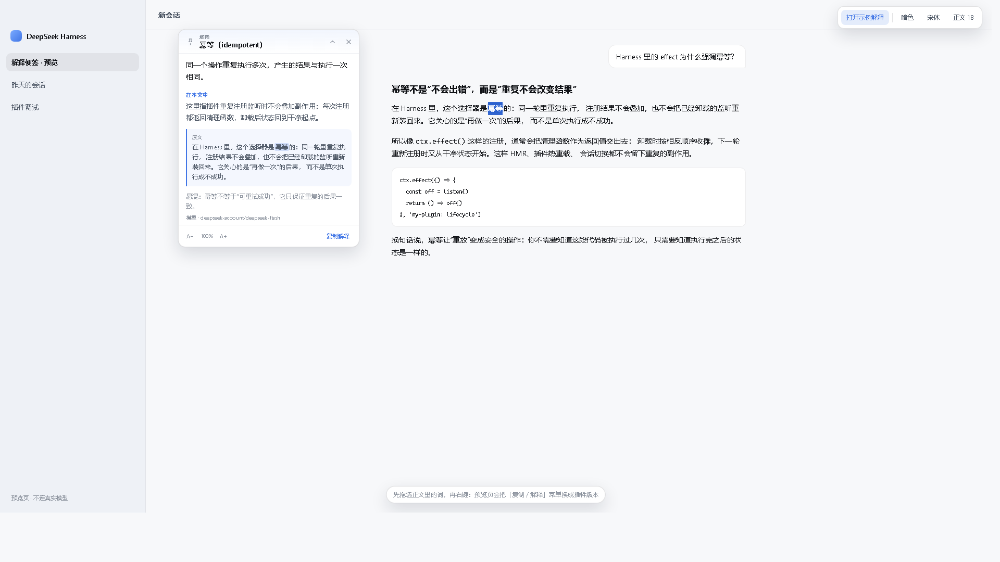
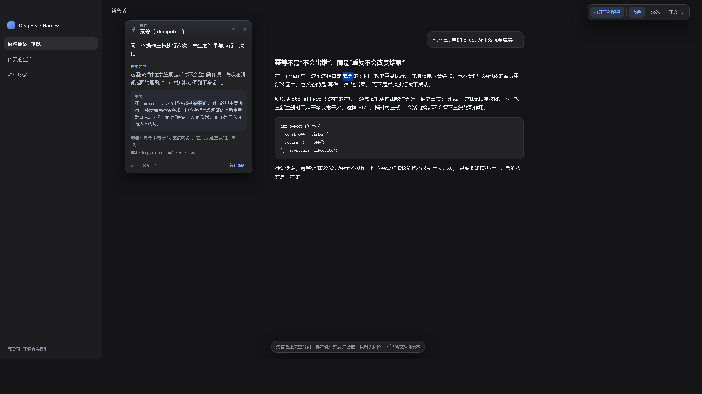
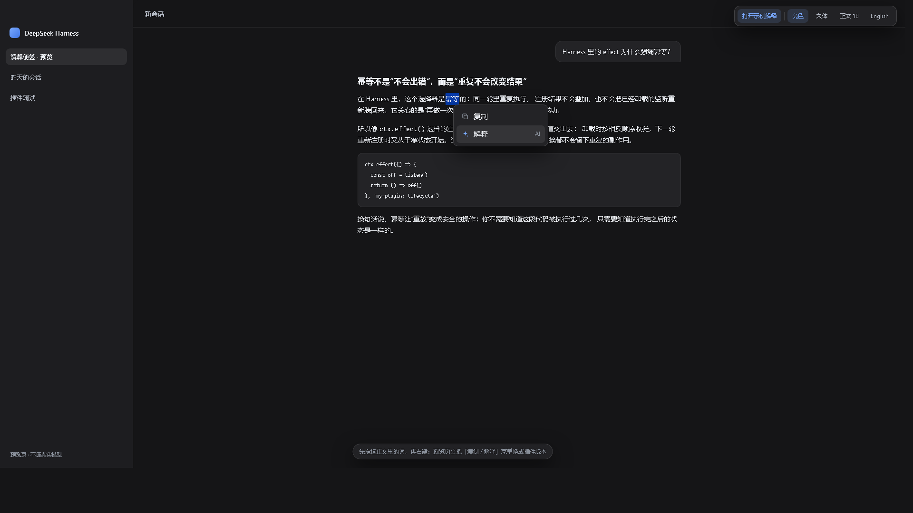
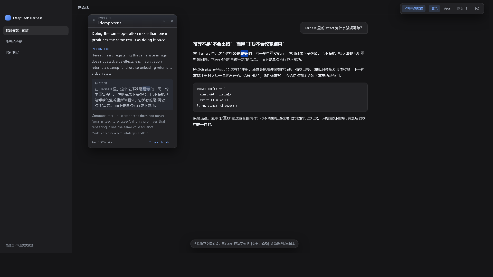

# dsh-explain-note

在 DSH 的 AI 回答里选中一个词，右键点「解释」，就会在**会话区与左侧栏之间的空隙**里开一张便签：可拖拽、可折叠成一条栏、可关闭、可固定，字号能单独放大缩小。解释由当前配置的模型生成，会结合选区所在的段落、整段回答和用户的问题，而不是查百科。菜单、便签标签和解释正文都会跟随 DSH 当前界面语言（中文 / English）。

> GitHub：https://github.com/Plyhi/dsh-explain-note · 已在 DSH 0.2.0-rc.2 桌面端验证宿主路由、客户端 bundle 和真实模型解释。





右键菜单（深色）：



英文界面下的便签：



---

## 交互

| 操作 | 结果 |
| --- | --- |
| 在 AI 回答里拖选文字 → 右键 | 原生右键菜单被替换成「复制 / 解释」两项；别处（输入框、侧边栏、用户消息）仍是原生菜单 |
| 点「复制」 | 复制选中的文字，菜单短暂显示「已复制」 |
| 点「解释」 | 在左侧空隙里新建一张便签，先显示骨架屏，模型返回后填入释义 |
| 拖标题栏 | 移动便签，始终夹在窗口内，并且不会钻进 Windows 标题栏 |
| 📌 | 固定：锁住位置、禁止拖动，并置顶，避免被后来的便签盖住 |
| ⌃ | 折叠成一条 300px 的栏；再点展开 |
| × | 关闭并中止还没返回的请求 |
| A− / A+ | 字号在 85%–160% 之间缩放；下一次新便签会记住这个比例 |
| 复制解释 | 把标题、释义、语境、原文摘录拼成纯文本复制 |

- 同一段回答里重复解释同一个词，会复用已有便签（展开、置顶、闪一下），不会无限堆叠。
- 新便签默认在左侧空隙里从上往下堆；放不下时换到右边一列。
- 便签只存在于当前页面会话，刷新后消失——它不写会话历史，也不占模型上下文。

---

## 安装

用 DSH 的插件管理器从 GitHub 安装：

```powershell
dsh plugin --profile <你的 profile> add github:Plyhi/dsh-explain-note
```

也可以先 clone，再按本地目录装：

```powershell
git clone https://github.com/Plyhi/dsh-explain-note
dsh plugin --profile <你的 profile> add file:/path/to/dsh-explain-note
```

桌面版的 `dsh` 在安装目录的 `resources\runtime\cli\bin\dsh.cmd`；也可以直接在插件管理器里填 `Plyhi/dsh-explain-note`。

装完通常由插件管理器热挂载；如果右键菜单没出现，刷新一次页面（Ctrl+R），再不行就重启 DSH。卸载：

```powershell
dsh plugin --profile <你的 profile> remove dsh-explain-note
```

> 需要 DSH 0.2.0-rc.2 或相近版本；插件不依赖任何 npm 包，也不 import `@deepseek-ai/*`，只通过 `ctx` 拿服务。

---

## 配置模型

默认跟随「设置 → 模型」里 `agentDefaultModel` 当前选中的路线。想固定成别的模型，打开 `cordis.patch.yml` 里的注释：

```yaml
- insert:
    - id: explain-note
      name: dsh-explain-note
      config:
        provider: deepseek-account
        model: deepseek-flash
```

`provider` 和 `model` 要么都填，要么都不填；只填一个会退回默认选择。

---

## 主题适配怎么做的

没有硬编码任何一套配色，而是从当前页面**实际生效的样式**里取：

1. **颜色**：使用 DSH 的 `--dsw-*` token（`--dsw-alias-bg-overlay`、`--dsw-alias-label-primary`、`--dsw-alias-border-l2`、`--dsw-alias-brand-primary`、`--dsw-shadow-lv3`、`--dsw-radius-lg`、`--dsw-menu-backdrop-filter` 等）。
2. **皮肤覆盖**：便签根节点带 `role="dialog"`，右键菜单带 `role="menu"`。深海女仆这类主题会把 dialog / menu 的 token 覆盖写在这两个角色上，所以便签会自动拿到皮肤的面板色、金边和文字色。
3. **字体**：从选区所在段落的 `getComputedStyle` 里抄 `font-family` 和 `font-size`。字体插件（比如宋体 + Times New Roman）不管用 `!important` 还是只改 `--dsw-font-family`，便签都会跟正文一致；代码用同一段里 `<code>` 的等宽字体。
4. **实时跟随**：`MutationObserver` 盯着 `html` / `body` 的主题属性、style 和 `<head>` 里新注入的样式；切明暗、换皮肤、换字体插件、改正文字号时，已经开着的便签会重新取色取字。
5. **兜底**：如果主题没定义某个 token，就用选区旁边卡片的实际背景色/文字色；再不行才用明暗两套中性色。

---

## 实现结构

```
dsh-explain-note/
  package.json        bundle 清单（dsh.bundle.patch + dsh.client）
  cordis.patch.yml    把宿主插件插进 profile
  index.js            宿主半端：POST /api/explain-note/explain
  client.js           浏览器半端：右键菜单 + 便签 UI + 主题/拖拽/折叠/固定
  preview/            独立预览页（不参与安装）
```

**宿主半端**（`index.js`）

- 只接受本机同源请求；能拿到 `connection.requestRejection` 时先过 DSH 的信任栅栏。
- `ctx.llm.stream()` 调一次独立模型请求，`temperature 0.35`、`maxTokens 480`、90 秒超时。
- Prompt 要求模型只输出四个短字段：

  ```json
  {"term":"…","brief":"…","in_context":"…","note":"…"}
  ```

- 服务端会剥代码块、兜底解析纯文本、裁剪长度；模型抽风时不至于让便签空着。
- 同时最多 3 个解释请求，超了返回 429。

**浏览器半端**（`client.js`）

- 自注册格式：`window.__ModuleLoader__.load({ id: 'dsh-explain-note', factory() { … } })`。
- 只接管 `[data-chat-flow-kind="assistant*"]` 里的选区；`contextmenu` 捕获阶段里 `preventDefault()`，所以不会再弹 Electron 原生菜单。
- 便签用 `position: fixed`，拖拽/缩放/窗口 resize 都统一夹在 `innerWidth × innerHeight` 内，顶边留出标题栏高度。
- 便签、菜单都插在 `document.body` 末尾，z-index 在正文之上、设置弹窗之下。

---

## 已知边界

- **原生菜单加不进去**：Electron 的右键菜单是在主进程 `webContents.on('context-menu')` 里拼的，插件没有这个钩子。所以这里的做法是「只在回答区域接管右键，自绘一个同样带复制按钮的菜单」；其他区域的右键行为完全没变。
- **依赖聊天 DOM 标记**：靠 `data-chat-flow-kind` / `data-chat-turn` / `data-chat-flow` 找回答和上下文。DSH 如果改这些标记，需要同步改 `readSelection()`。
- **不持久化**：便签不写 localStorage / 会话日志，刷新即消失；只记住字号比例。
- **不进入会话历史**：解释是一次旁路模型调用，不会出现在聊天记录里，也不影响后续对话的 token。
- **语言跟随界面**：菜单、便签静态标签、错误提示都读 `ctx.locale` 的当前语言；解释正文也会按当前语言请求模型（中文 / English）。切换语言后已打开的便签会更新标签，但正文不会自动重译，重新点一次「解释」即可。

---

## 独立预览

不装插件也能看 UI：

```powershell
start preview/preview.html?auto=1
```

- `?auto=1`：自动选中示例里的「幂等」并打开解释便签。
- `?menu=1`：只弹右键菜单。
- `?dark=1`：深色。
- `?serif=1`：宋体。

预览页用本地假数据代替宿主接口，只验证排版、菜单、主题和交互，不调用模型。

---

## License

MIT
